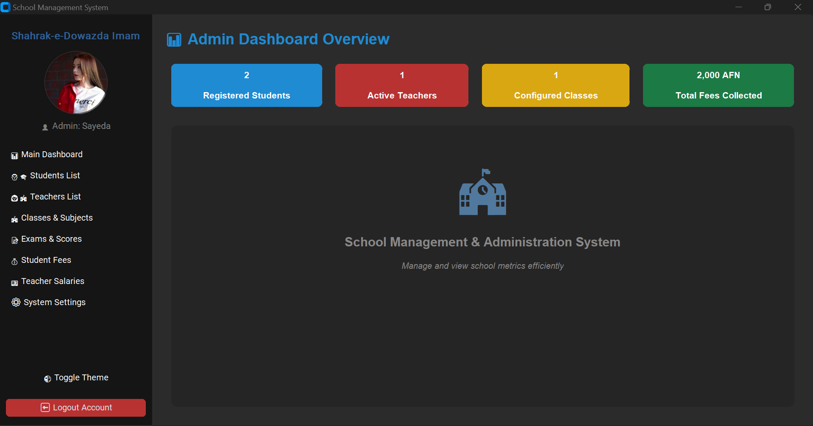

<p align="center">
  
</p>

# 🏫 School Management System

A modern and professional **School Management System** designed to handle school admin tasks smoothly. Built with Python, this app features a beautiful, clean user interface and high-performance database tracking.

---

## ✨ Key Features

- **Multi-Page App:** Separate screens for Login (`login page.py`), Registration (`register page.py`), and Dashboard (`home page.py`).
- **Beautiful Profile Picture:** High-resolution circular avatar with an adjustable colorful border.
- **Smart Theme Engine:** Supports seamless shifting between Light and Dark modes.
- **Secure Database:** Handled locally via SQLite (`database.py`) to keep school data safe.

---

## 🛠️ Tech Stack

- **Language:** Python 3.x
- **GUI Framework:** CustomTkinter (Modern UI)
- **Image Processing:** PIL (Pillow)
- **Database:** SQLite3

---

## 📦 Prerequisites

Before launching the project, install these two required libraries using your terminal:

```bash
pip install customtkinter pillow pyinstaller
```

---

## 🚀 How to Run the Application

The entire system is connected through one single entry point. **Do not run individual page files by themselves.**

To open the application, simply run the **`main.py`** file:

```bash
python main.py
```

---

## 📁 Project Architecture (Files)

- 📄 **`main.py`** - The main key of the application. **Always run this file first.**
- 📄 **`app.py`** - Controls window swapping and core navigation routing.
- 📄 **`database.py`** - Stores tables, SQL queries, and admin login data.
- 📄 **`home page.py`** - The primary admin dashboard containing profile configurations.
- 📄 **`login page.py`** & **`register page.py`** - Gateways for user authentication.

---

## 💻 Converting to a Real Windows App (.exe)

You can package this project into a standalone executable file so users can open it like a regular desktop app without needing to install Python.

Run this simple command in your terminal to build your `.exe` app:

```bash
pyinstaller --noconfirm --onedir --windowed --add-data "School_Management_System.db;." main.py
```

*Note: Once compiling is finished, your ready-to-use software will be waiting inside the `dist/main/` folder.*